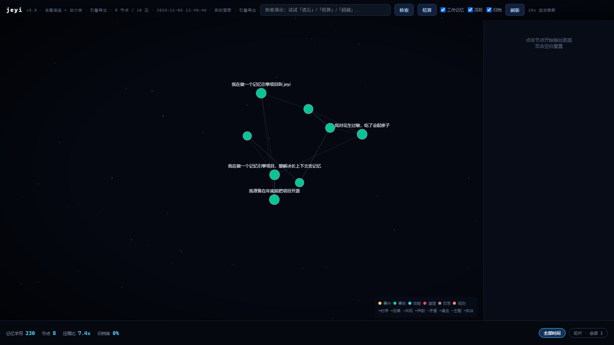

memory-brain-agent · v4.6 记忆脑图引擎
========================================
哲学：发现现成的，超越现成的——**超越必须接受检验**。

30 秒上手
--------
`ash
git clone https://github.com/y50008/memory-brain-agent.git
cd memory-brain-agent
python demo.py                 # 零依赖，立刻能跑
python tests/test_brain.py     # 40/40
`
想要更高召回：pip install -e ".[dense]" && python tools/setup_dense.py（24MB 本地模型）。

- **介绍**（这是什么、和别的方案比、数字怎么读）→ [docs/INTRO.md](docs/INTRO.md)
- **安装使用**（装、跑、接大肥鱼、开机自启、排错）→ [docs/INSTALL.md](docs/INSTALL.md)

这是什么
--------
一个可运行的 Agent 长期记忆引擎，目标是同一句话：
**用固定的、极小的 token 预算记住一个人几个月的事，并且记得住、找得回、改得口。**

每一次回复只注入 ≤300 字的记忆（不随对话历史增长），
换来的是一条可检索、可衰减、可改口、可审计的记忆图谱。

v4.6 的核心变化：**"打分/选包"重做成可测量的检索系统**，补上 v3.1.1 缺失的检验
（主集 + 留出集 + 一年时间线三套），并在不牺牲弃答的前提下把留出集从 77.8% 提到 85.2%。

先看数字（合成语料，见 docs/VALIDATION.md 的诚实声明）
------------------------------------------------------------
**两种配置，同一套代码**。零依赖装完就能跑 96.2%；装上 24MB 的本地向量模型到 98.1%。

| | 纯词法（零依赖） | **+ 稠密（推荐）** | 整段上下文 |
|---|---|---|---|
| 主集 rank@5（53 问） | 96.2% | **98.1%** | 100% |
| 主集 投递命中 | 95.8% | 95.8% | 100% |
| **留出集 rank@5（27 问，改写问法）** | 77.8% | **85.2%** | 100% |
| 留出集 投递命中 | 70.8% | **79.2%** | 100% |
| 越界问题弃答 | 100% | 100% | 0% |
| 每轮注入字符 | 36.5 | 43.3 | 484 |
| 检索延迟（52 条记忆） | 0.2 ms | 2.8 ms | — |
| 一次性成本 | 0 | 24MB 模型 + 3 个 wheel | — |

**留出集才是真话**：主集的问题大量复用记忆原词（"我对什么过敏"→"我对花生过敏"），
留出集是改写过的（"我身体有哪些毛病"→"颈椎不好"，零词面重合）。
词法 77.8% → 稠密 85.2%，差的这 7.4 个点就是"有没有语义模型"的差别；
而剩下的 14.8% 是连 bge-small 都接不住的推理题（"行当"→"建筑设计"）。

为什么是这个组合（而不是更大模型 / 重排器 / API）：

| 方案 | 留出集 | 单次成本 | 每轮延迟 | 结论 |
|------|--------|----------|----------|------|
| 纯词法 | 77.8% | 0 | 0.2 ms | 兜底，够用 |
| **bge-small-zh int8 + 词法 RRF** | **85.2%** | **24MB 一次性** | **~2.8 ms** | **选它** |
| bge-base-zh（更大） | 预期 +2~3 | 400MB | ~8 ms | 边际收益远小于体积 |
| cross-encoder 重排 | 预期 +3~5 | 300MB+ | +300~800 ms | 太慢，且要两阶段 |
| 远程 embedding API | 与本地相当 | ≈$0.04/年 | +150~300 ms | 省磁盘但慢、且个人记忆出网 |

个人记忆里有病史、家庭、收入——**不出网**这件事值钱，所以选本地小模型。

启用（两步，约 40 秒）
----------------------
```bash
pip install -e ".[dense]"     # numpy + onnxruntime + tokenizers
python tools/setup_dense.py   # 下 24MB int8 模型 + 自检语义 + 打印真实延迟
```
```python
from brain import MemoryHooks
from brain import dense
ag = MemoryHooks(embedding=dense.make_embedder())   # 装不上就返回 None，自动退回词法
```
不装也完全能跑——`brain/dense.py` 只在依赖与模型都在位时才加载，核心库保持零依赖。

公开基准（语料由外人提供，`tools/bench_external.py`）
----------------------------------------------------
测检索层（证据有没有被找回），不测问答（那要 LLM 判分）。

| 基准 | 词法 | + 稠密 |
|------|------|--------|
| **LoCoMo**（英文，1986 问，证据是"某一轮对话"） | 48.6% | **50.9%**（稠密只肯加不肯抢） |
| **LongMemEval-S**（英文，50 问，证据是"整段会话"） | 92.0% | **96.0%**（等权可到 98.0） |

同一个引擎、同一个模型，两个基准结论相反——差别在**记忆单元是否自包含**。
LoCoMo 的每轮对话满是 "I'm really lucky to have them" 这种指代，单独抽出来做向量本来就缺信息；
LongMemEval 的记忆是自包含陈述。我们的记忆写成自包含的 gist，属于后者。
详见 docs/VALIDATION.md §三之五。

长时程（`python tools/simulate.py`：把一年压进 3 秒）
----------------------------------------------------
可注入时钟（`brain/clock.py`）让"半年后会发生什么"第一次变成可验证的东西：

| 天 | 工作 | 活跃 | 归档 | 核心可检索 | 小事已归档 | 小事常规 | 小事显式 |
|---:|-----:|-----:|-----:|-----------:|-----------:|---------:|---------:|
| 0 | 5 | 19 | 0 | 3/3 | 0/18 | 18/18 | 18/18 |
| 90 | 5 | 25 | 0 | 3/3 | 0/18 | 18/18 | 18/18 |
| 180 | 1 | 31 | 0 | 3/3 | 0/18 | 18/18 | 18/18 |
| 365 | 1 | 7 | 25 | 3/3 | 17/18 | 1/18 | 18/18 |

读到的是：反复提起的核心记忆一年后仍在；随口一提的小事 17/18 归档；
归档之后常规检索取不到（`1/18` 那条是作为图邻居被顺带提起过、复述刷新的，属设计行为）；
但**显式回忆（"你还记得…吗"）能把 18/18 全部取回**——这份记忆卡永远在。
两条承诺分别在到期前一天被主动提起（`2026-01-09`、`2026-02-28`）。

会话作用域与跨会话同一性（v4.6）
--------------------------------
"避免会话之间互相干扰"要同时解决两件事，它们是正交的：

| | 问题 | 机制 |
|---|---|---|
| **隔离** | 上个会话的临时方案，下个会话还被翻出来 | `Node.scope`：`user` 跨会话可见 / `session` 只在产生它的会话可见 |
| **同一性** | 同一件事在十个会话里存成十份 | `Node.sessions`：合并成一张卡，记录"在哪些会话被确认过" |

```python
ag = MemoryHooks(session="S1")
ag.on_message("我对花生过敏")                        # 长期记忆：任何会话都可见
ag.remember("先做登录页，下周再排期", scope="session")  # 会话私有：换个会话就隐身

ag.set_session("S2")                                 # 切会话：清注入去重表，保留记忆
r = ag.before_reply("登录页 花生")
# → 注入包里有「花生」，没有「登录页」
```

**同一性**：S2 里再说一次"我对花生过敏"，不会新开一张卡，而是把 `S2` 记进
`sessions`、置信度 +0.02、`hits` 累计。`stats()["cross_session"]` 就是"在 ≥2 个会话里
被确认过"的记忆条数——这比单次写入更可信。

不用手动标：`我本次…/我本轮…/这段对话…` 这类说法自动落成会话私有。
隔离对三条检索路径同时生效（词法、稠密、**图扩散**）——漏掉任何一条都等于没隔离。



接入大肥鱼（dsh-identity，v4.6）
----------------------------
[dsh-identity](https://github.com/Anarrogantcat/dsh-identity)（MIT，「大肥鱼 · 身份系统」）
自带一套记忆实现，没有留插拔点。但我们**不需要它配合**：它的 lib/memory.js 是一组具名导出，
换掉这一个文件就能只替换"哪几条记忆进上下文"这一层，index.js 一行不改。

`ash
# 1. 起引擎（另开终端或开机自启）
python -m brain.serve --port 8765 --store ./data/peers --dense
# 2. 把桥装进大肥鱼
cd <dsh-identity>/lib && mv memory.js memory.orig.js
cp <memory-brain>/integration/dsh-identity/memory.bridge.js ./memory.js
cp <memory-brain>/integration/dsh-identity/memory.fetch-worker.mjs ./
# 3. 用大肥鱼真实的 memory.js 做对照验证
python tools/verify_fish_bridge.py --fish <dsh-identity 包目录> --dense
`

实测（跑的是它自己的模块和存储）：**原实现 3/4，桥接 4/4**——
多跳问句「我家猫身体有什么问题」原实现返回空，因为我们把「猫→团子→海鲜过敏」
用图扩散接上了；弃答、面板接口（listMemory/memoryStats/forgetMemory）全部保持。

引擎挂了不影响大肥鱼：桥接在 30 秒内自动退回原实现。
细节与三个集成坑见 [integration/dsh-identity/README.md](integration/dsh-identity/README.md)。

快速开始
--------
```bash
python demo.py                 # 端到端：写入→建图→检索→多跳→弃答→召回→改口→结算→指标
python tests/test_brain.py     # 40 项测试（无 pytest 依赖）
python tools/bench.py          # 检索质量基准（主集）：v3 基线 vs v4 vs 整段上下文
python tools/bench.py --holdout# 留出集：泛化能力的诚实读数
python tools/bench.py --dense --holdout  # 稠密混合（需先 setup_dense，venv 里跑）
python tools/fetch_bench.py --dataset locomo       # 下公开基准（2.8MB）
python tools/bench_external.py --dataset locomo --dense --lang en
python tools/simulate.py       # 一年时间线：衰减/归档/到期提醒/显式回忆
python tools/replay.py         # 多轮会话回放：看注入包与省下的 token
python tools/export_map.py     # 导出真实脑图 → ui/brain_map_live.html（双击即看）
```

接入你的 Agent（四个钩子）
-------------------------
```python
from brain import MemoryHooks

ag = MemoryHooks(store_dir="./data")          # 零依赖，默认 JSONL 事件溯源

# 每条用户消息：
ag.on_message(user_text)                      # 写入：三通道 + 建图 + 去重 + 改口
# 生成回复前：
ctx = ag.before_reply(user_text)              # 检索 + 选包
system_prompt += ctx["pack"]                  # ctx["pack"] 是 ≤300 字的记忆块
# 模型输出后：
pending = ag.handle_turn(model_output)        # 解析 [[recall: 词]]，下一轮强制补入
# 会话结束：
ag.on_session_end()                           # 五步结算 + 归档 + 落盘
```

生产替换点（诚实声明）
--------------------
| 位置 | 现状 | 生产建议 |
|------|------|----------|
| 语义召回 | 词法（二元组+一元组+别名表） | 接 `OpenAICompatibleEmb`（任何 /v1/embeddings）；同义改写只能靠它 |
| 冲突复核 | `HeuristicJudge` 词面复核 | 换 `OpenAICompatibleLLM`，已在 `settle()` 接线，失败自动降级为待复核 |
| 写入抽取 | 规则（第一人称/句读/情绪词/日期） | 可换 LLM 抽取，接口在 `hooks.on_message` |
| 衰减/注入常数 | 30 天半衰期、300 字预算 | 用 `tools/bench.py` 在你自己的数据上重校准 |

```python
from brain import MemoryHooks, SqliteStorage, OpenAICompatibleEmb, OpenAICompatibleLLM
ag = MemoryHooks(storage=SqliteStorage("./data/brain.db"),
                 embedding=OpenAICompatibleEmb("https://api.example.com", "KEY", "bge-small"),
                 judge=OpenAICompatibleLLM("https://api.example.com", "KEY", "your-model"))
```

架构（v4）
---------
```
你 → on_message ──► lang.py 分词/情绪/日期/实体 ──► core.py 节点+边+状态机
                                                        │ 事件溯源
                                                        ▼
                                                  storage.py (events.jsonl / sqlite)
你 ← before_reply ◄── pack.py 预算选包 ◄── score.py 倒排索引+余弦门控+图扩散
```

| 模块 | 职责 | v4 关键点 |
|------|------|-----------|
| `brain/clock.py` | 唯一时间源 | 可注入虚拟时钟，长时程行为变成可验证 |
| `brain/dense.py` | 稠密检索（可选） | 本地 ONNX 句向量（中/英两版）+ numpy 向量索引；不装依赖时整层不加载 |
| `brain/lang.py` | 文本原语 | 全项目唯一分词器；中文二元组+内容字一元组+停用词 |
| `brain/core.py` | 全图底座 | 节点/真实边/状态机/按天归档/三切片/`due_at` |
| `brain/score.py` | 检索 | 倒排索引、tf-idf 余弦门控、**可用的**扩散激活与侧抑制、显式回忆 |
| `brain/pack.py` | 选包 | 预算内 MMR、会话去重、必含桶（召回/纠错/到期） |
| `brain/settle.py` | 结算 | 五步结算、idf 加权冲突候选、图式挂载、回响 |
| `brain/hooks.py` | 四钩子 | 写入抽取器、注入编排、召回协议闭环 |
| `brain/storage.py` | 持久化 | 事件溯源（create/patch/edge）、SQLite WAL、v3 迁移 |
| `brain/persona.py` | 人格层 | 证据制 traits、心情半衰、偏置封顶 |
| `brain/adapters.py` | 适配 | embedding / LLM / 冲突复核 |

三通道与双卡制（设计意图，v4 才真正接通）
----------------------------------------
- **通道 1 gist**：极慢衰减的意义轮廓，注入包的主体。
- **通道 2 verbatim**：用户原话锚点。v3 从不注入；v4 只在"24h 内被改口"或
  "用户问的正是那句原话"时附带，兼作防图式失真的纠错锚点。
- **通道 3 feeling**：情绪快照（label/valence/arousal/why/valid_at），7 天半衰，
  参与 `E` 与心情对齐，命中时以 `〔情绪〕` 紧凑标记注入。
- **双卡制**：live 卡可注入可衰减；全量卡是 append-only 事件流，永不注入、永不删改。
  v3 的实现是反的（重启后 superseded 会复活），v4 用事件重放修正。
- **三切片**：working（最近 7 天最活跃的 5 条）/ active / archive 真的都在用；
  归档不等于删除——常规检索不翻归档，但"你还记得…吗"和 `[[recall:]]` 能把它取回来（行首 `↩` 标记），
  这样才对得上「没有真正的遗忘，也没有不遗忘」。

移植与重构
----------
- `docs/design-spec.md` —— 人工重构蓝图（模块/公式/契约/字段表），可直接照着重写。
- `docs/FIXES.md` —— v3→v4 的 B1–B16 修复清单（每条都有对应测试名）。
- `docs/VALIDATION.md` —— 已验证 / 未验证清单与测量方法。

目录
----
```
brain/            引擎（clock/lang/core/score/pack/settle/hooks/storage/persona/adapters）
tests/            36 项测试
tools/            bench.py 基准 · bench_external.py 公开基准 · fetch_bench.py 下载
                  export_map.py 导出脑图 · ci_gate.py 质量门禁
ui/brain_map.html 脑图模板（无外部依赖）
ui/brain_map_live.html  由引擎导出生成的真实脑图
demo.py           端到端演示
```

血缘与许可
----------
打分结构与部分常数（半衰期公式、断崖注入、person floor、24h 强插、字符预算、
`[[recall:]]` 协议）校准自 `Anarrogantcat/dsh-identity`（MIT），已在 `docs/design-spec.md` 署名。
本项目代码为本项目逐行自写，采用 MIT（见 LICENSE）。
